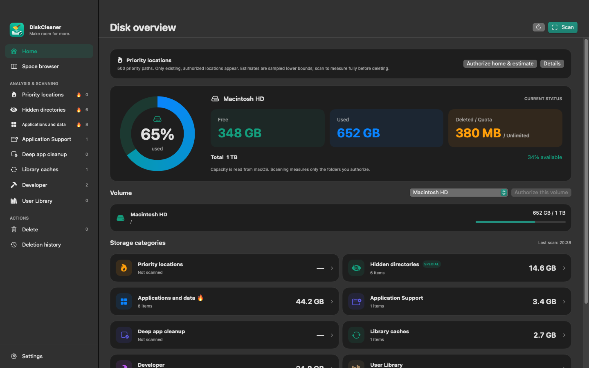

# DiskCleaner

See what is really filling your Mac, and delete it safely. DiskCleaner measures hidden
dot-folders, app leftovers and Library caches, then tells you which app owns each folder and
what happens if you remove it. Everything goes to the Trash first, so a mistake is recoverable
until you empty it.

[**Download on the Mac App Store**](https://apps.apple.com/app/id6838353078)

## Why people use it

- **Hidden folders, explained.** Your home folder hides dozens of dot-directories: `.npm`,
  `.gradle`, `.docker`, `.cache`, model and simulator downloads. DiskCleaner measures them as
  whole folders and shows the owning software, a safety label and the consequence of deleting
  each one.
- **No more guesswork.** "4.8 GB" next to `.gradle` is useless without context. You get the
  actual purpose, whether the data is rebuilt automatically, and whether credentials or
  settings live inside.
- **Applications and data in one place.** Each installed app is listed with its real icon and
  bundle size, plus the Application Support folders it owns. Delete the leftover data of an
  app you already removed, or the bundle and its data together.
- **Deep app cleanup.** Matches support folders by exact name, bundle identifier and known
  aliases, so shared vendor folders and Apple system data stay out of the list.
- **Space browser.** Column by column, largest first: home, Library, Caches, and down to the
  folder that actually takes the space. Sizes are measured recursively, not guessed.
- **Priority locations.** 500 curated paths for the usual suspects, so the first scan is
  useful instead of blank.

## Safety first

- Files are moved to the **macOS Trash**, never deleted outright. The deletion history can put
  them back while they are still there.
- Every deletion re-checks the file identity, so a folder that changed after scanning is
  refused instead of silently removed.
- The app runs in the **App Sandbox** and can only read the folders you authorize. It never
  asks for Full Disk Access and cannot bypass macOS privacy protection.
- iCloud and cloud-provider folders are excluded from scanning and cleaning.

## Free and full version

Scanning, every scope, the space browser, the descriptions for each folder and the deletion
history are free in all eight languages. The free version can delete up to 2 GB in total. The
full version is a one-time purchase (no subscription, no account) and unlocks unlimited
deletion, Finder reveal, path copying, batch restore and the deep app cleanup page.

[**Get the full version**](https://apps.apple.com/app/id6838353078)

## Privacy

No account, no analytics, no advertising, no uploads. Scan results and history stay on your
Mac and can be cleared inside the app. Purchases are handled by Apple through the App Store.

- [Privacy policy](doc/en/privacy-policy.md) · [中文](doc/zh-Hans/privacy-policy.md)
- [Terms of service](doc/en/terms-of-service.md) · [中文](doc/zh-Hans/terms-of-service.md)

## Requirements

macOS 13.5 or later, Apple silicon or Intel. Eight languages: English, Simplified Chinese,
Traditional Chinese, French, Spanish, German, Japanese and Korean.

## Support

Questions, bug reports and feature requests: please
[open an issue](https://github.com/bosseye-app/DiskCleaner/issues).
